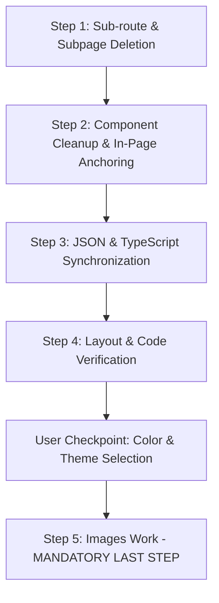

# HomeOne Landing Page Blueprint & Automated Conversion Rules (HOMEONE_AGENT.md)

> **CRITICAL DIRECTIVE & SINGLE SOURCE OF TRUTH:**
> This file is the **universal, automated blueprint** for converting any multi-page template into a pure "HomeOne" single-page landing site, or creating a new HomeOne template from scratch.
> Any developer or AI Agent working on this repository **MUST EXECUTE ALL STEPS AUTOMATICALLY** upon receiving a conversion or setup task.
> Follow this exact sequence with zero deviation.

---

## 1. Core Mission: 100% Pure Single Landing Page

1. **ONLY 1 Main Page (`app/page.tsx`):**
   - The entire website lives on the homepage `app/page.tsx`.
   - **NO inner pages / sub-routes:** Automatically delete all inner directories in `app/` (e.g. `app/about/`, `app/services/`, `app/contact/`, `app/team/`, `app/why-choose-us/`, `app/our-approach/`, etc.).
   - **NO dynamic detail pages:** Automatically delete all dynamic folders (e.g. `app/services/[id]`, `app/industries/[id]`, `app/team/[id]`, `app/blog/[id]`, etc.).
   - Only `app/layout.tsx`, `app/page.tsx`, `app/globals.css`, and optional `app/not-found.tsx` are allowed in `app/`.

2. **Clean Up Unused Components & Sections:**
   - Any component created strictly for subpages (e.g., `Breadcrumb.tsx`, `DetailSidebar.tsx`, `InnerPageGrids.tsx`, `DetailContent.tsx`) **MUST BE COMPLETELY DELETED**.
   - Keep only the components actively rendered on `app/page.tsx` (and common `Header.tsx`, `Footer.tsx`).
   - Clean up corresponding interfaces in `types/templates.types.ts` and entries in `data/templates.json`.

3. **Component Simple Naming Rule (CRITICAL):**
   - All section component files, exports, and JSON template keys MUST use clean, simple names **without** appending redundant suffixes like `"Section"` or `"Page"`.
   - **Examples:**
     - `AboutUs.tsx` (export `AboutUs`, key `'AboutUs'`) — NEVER `AboutUsSection.tsx`
     - `Hero.tsx` (export `Hero`, key `'Hero'`) — NEVER `HeroSection.tsx`
     - `Services.tsx` (export `Services`, key `'Services'`) — NEVER `ServicesSection.tsx`
     - `Pricing.tsx` (export `Pricing`, key `'Pricing'`) — NEVER `PricingSection.tsx`
     - `Testimonials.tsx` (export `Testimonials`, key `'Testimonials'`) — NEVER `TestimonialsSection.tsx`
     - `Faq.tsx`, `Process.tsx`, `Brands.tsx`, `Achievement.tsx`, `WhyChooseUs.tsx`, `BookRepair.tsx`
   - Maintain 100% naming consistency across the component file, the export name, the import in `app/page.tsx`, and the `key` in `templateComponents.pages.home.components`.

4. **In-Page Anchor Navigation (`#section-id`):**
   - All navigation links in Header, Hero CTA, and Footer must point to **in-page anchors** on the landing page (e.g. `/#about`, `/#services`, `/#process`, `/#why-choose-us`, `/#testimonials`, `/#contact`).
   - Every section in `app/page.tsx` must have the corresponding `id="..."` attribute matching the link href.
   - Smooth scrolling enabled on `html` / `main` (`scroll-smooth`).
   - Remove dead / fake buttons that lead to non-existent detail pages. If an action button is needed, redirect it to `/#contact` or trigger the contact/quote form.

5. **NO Blog Rule (STRICT — DO NOT INCLUDE BLOGS ON LANDING PAGES):**
   - **We do NOT need Blogs on HomeOne landing pages.**
   - Do NOT include blog sections (`Blog.tsx`, `BlogSection.tsx`, `BlogGrid.tsx`, `BlogDetail.tsx`) on the landing page or anywhere in the codebase.
   - Remove all Blog data, posts, and keys from `data/templates.json` and all blog interfaces from `types/templates.types.ts`.
   - Remove Blog navigation links from both Header and Footer.

---

## 2. Tech Stack (FIXED — Do NOT change)

| Package | Version | Notes |
|---|---|---|
| **Next.js** | `15.x` / `16.x` | App Router (`app/` folder at project root) |
| **React** | `19.x` | Functional components only |
| **TypeScript** | `5.x` | Strict mode enabled |
| **Tailwind CSS** | **`3.4.17`** | **CRITICAL: v3 ONLY** — v4 breaks CSS generation |
| **PostCSS** | Latest | `tailwindcss` + `autoprefixer` plugins |
| **react-icons** | `^5.x` | Unified icon library |

### Tailwind CSS Version Rule
- **NEVER upgrade to Tailwind v4.**
- `postcss.config.mjs` must use `tailwindcss` and `autoprefixer`:
  ```javascript
  const config = {
    plugins: {
      tailwindcss: {},
      autoprefixer: {},
    },
  };
  export default config;
  ```
- `globals.css` must use standard v3 directives:
  ```css
  @tailwind base;
  @tailwind components;
  @tailwind utilities;
  ```

---

## 3. Standard Execution Workflow (ORDER OF OPERATIONS)

Whenever a project is converted to HomeOne, the agent **MUST** follow this exact execution sequence:



### Step 1: Remove Inner Pages & Sub-routes
- Automatically delete all subdirectories inside `app/` except root files (`layout.tsx`, `page.tsx`, `globals.css`, `not-found.tsx`).
- Automatically delete all unused components inside `components/sections/` and `components/common/` that belonged exclusively to subpages or detail routes.

### Step 2: Implement Single Landing Page Anchors
- Ensure every landing section has an `id` attribute matching the navigation (e.g., `id="about"`, `id="services"`, `id="contact"`).
- In `components/common/Header.tsx`, `Footer.tsx`, and `Hero.tsx`, map all menu links to `#section-id` anchors.
- Remove all orphaned "Read More", "View Details", or subpage navigation buttons that have no landing page target.

### Step 3: Synchronize JSON and Types
- In `data/templates.json`:
  - `pages` object must only define `"home"`.
  - Its `components` array must strictly match the sections imported in `app/page.tsx`.
  - Remove all unused subpage data blocks from `data/templates.json`.
  - **Variant Naming Rule (CRITICAL):** All section variant keys (e.g. `WebserviceHeader1`, `WebserviceHero1`, `WebserviceAboutUs1`, etc.) must be renamed to variant `2` (e.g. `WebserviceHeader2`, `WebserviceHero2`, `WebserviceAboutUs2`), and synchronized across `data/templates.json`, `app/page.tsx`, and `types/templates.types.ts`.
- In `types/templates.types.ts`:
  - Remove unused types for subpages and deleted components.
  - Update variant interfaces to match variant `2` names.
  - Keep strict type safety (NO `any`, NO inline types).

### Step 4: Layout & Code Verification
- All layout structure, responsive grids, and components must be verified.
- **The ONLY remaining task before image handling should be the Color Theme decision.**

---

## 4. Color & Design Customization (User Focus)

All design styling must draw from CSS variables in `app/globals.css`:
```css
:root {
  /* Fonts */
  --font-primary: var(--font-poppins), sans-serif;
  --font-heading: var(--font-poppins), sans-serif;

  /* Global Color Tokens */
  --color-bg-main: #ffffff;
  --color-bg-card: #ffffff;
  --color-bg-alt: #f7f9f7;
  --color-primary: #111d2e;
  --color-accent: #028090;
  --color-accent-light: #00a896;
  --color-text: #1e293b;
  --color-text-light: #64748b;
  --color-border: #def0f0;
}
```

- When the user asks to change theme or colors, ONLY update the CSS variables in `app/globals.css`.

---

## 5. Spacing Guidelines (STRICT RULE)

- **Unified Container Width (CRITICAL):**
  - All landing sections must share the exact same outer container constraint:
    `max-w-[1280px] mx-auto px-4 lg:px-8`
  - Never mix random container widths. Keeping them strictly identical at `1280px` (`max-w-7xl`) provides the ideal balance between screen breathing room and rich visual density without feeling either bloated or overly shrunken.
- **Section Padding:** Use standard Tailwind classes: `py-8 lg:py-12` (32px to 48px) for outer section wrappers.
- **NEVER use huge arbitrary paddings** like `py-[100px]`, `pt-[120px]`, `py-[30px]`.
- **Card & Grid Spacing:** Use `gap-4` to `gap-8`.
- **Inner Padding is Sacred:** Do NOT alter button (`py-2`, `py-3`) or badge (`py-1`) inner paddings during refactoring.

---

## 6. MANDATORY RULE: Images Work is ALWAYS THE LAST STEP

> **CRITICAL RULE:** Image replacement, generation, and automated compression **MUST ALWAYS BE THE VERY LAST STEP**.
> Under NO circumstances should images be touched, swapped, or compressed until the layout, components, and colors are completely finalized.

### When executing the Image Step:
1. **Find & Replace Images:** Place relevant, optimized images in `public/` matching the theme.
2. **Compress ALL Images Automatically:**
   - Execute the standard in-memory `sharp` buffer script.
   - Target: JPG/WebP quality `80` with `mozjpeg` enabled.
   - Target file size: Total directory under **2 MB** (individual section images < 150 KB, avatars < 15 KB).
   - Zero broken image links in `data/templates.json`.

### Automated Compression Reference Script:
```javascript
const sharp = require('sharp');
const fs = require('fs');
const path = require('path');

async function compressDir(dir) {
  const files = fs.readdirSync(dir);
  for (const file of files) {
    const fullPath = path.join(dir, file);
    const stat = fs.statSync(fullPath);
    if (stat.isDirectory()) {
      await compressDir(fullPath);
    } else {
      const ext = path.extname(file).toLowerCase();
      if (['.jpg', '.jpeg', '.png', '.webp'].includes(ext)) {
        const inputBuffer = fs.readFileSync(fullPath);
        const originalSize = inputBuffer.length;
        let outputBuffer;
        if (ext === '.jpg' || ext === '.jpeg') {
          outputBuffer = await sharp(inputBuffer).jpeg({ quality: 80, mozjpeg: true }).toBuffer();
        } else if (ext === '.png') {
          outputBuffer = await sharp(inputBuffer).png({ quality: 80, compressionLevel: 8 }).toBuffer();
        } else if (ext === '.webp') {
          outputBuffer = await sharp(inputBuffer).webp({ quality: 80 }).toBuffer();
        }
        if (outputBuffer && outputBuffer.length < originalSize) {
          fs.writeFileSync(fullPath, outputBuffer);
          console.log(`${file}: ${(originalSize/1024).toFixed(1)}KB -> ${(outputBuffer.length/1024).toFixed(1)}KB`);
        }
      }
    }
  }
}
compressDir(path.resolve('public'));
```

---

## 7. Definition of Done Checklist

A project conversion or initialization is COMPLETE ONLY when:
- [ ] Only `app/page.tsx` exists (all subpages and dynamic routes deleted).
- [ ] All header, footer, hero buttons link to in-page `#section` anchors.
- [ ] All unused subpage components and deleted section types are removed.
- [ ] `data/templates.json` validates with zero syntax errors.
- [ ] Spacing strictly follows standard Tailwind classes (`py-8 lg:py-12`).
- [ ] Theme colors are strictly controlled via CSS variables in `app/globals.css`.
- [ ] Images are updated, compressed (< 2MB total for public folder), and completed as the final step after color approval.
